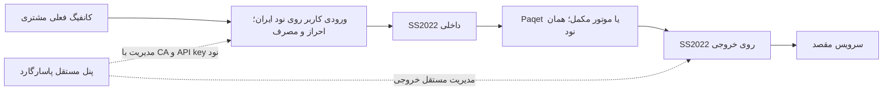

# هستهٔ یکپارچهٔ تونل: Paqet، Backhaul، GOST و FRP

Paqet موتور اصلی **تونل بین نودها** و انتخاب پیش‌فرض مسیرهای جدید در رابط است. Xray، حساب‌های فعلی، رمز/UUID کاربران، گروه‌ها، حجم، انقضا و سابلینک همچنان اجزای بومی پاسارگارد هستند؛ Paqet جای موتور احراز هویت کاربران را نمی‌گیرد. برای سازگاری کلاینت‌های API قبلی، مقدار پیش‌فرض API بدون تغییر SS2022 باقی مانده است.

سورس کامل سه پروژهٔ مکمل همراه مجوزها در `node/engines` وارد شده است. هر کدام یک موتور اجرای همان نود است؛ پنل و دیتابیس جدا نصب نمی‌شود. upstream، نسخه، commit واقعی و checksum آرشیو اولیه در [UPSTREAM.json](../node/engines/UPSTREAM.json) ثبت شده‌اند.

| موتور | نسخه و سورس | پروفایل‌های بومی فعلی | شروع ارتباط حامل |
|---|---|---|---|
| Paqet، اصلی | [hanselime/paqet](https://github.com/hanselime/paqet)، alpha.21 | KCP روی raw TCP؛ تنظیمات کامل Linux در [راهنما](NATIVE-PAQET.fa.md) | ایران به خروجی |
| Backhaul | [Musixal/Backhaul](https://github.com/Musixal/Backhaul)، 0.7.2 | TCP همراه `accept_udp`؛ UDP-over-TCP | خروجی به ایران |
| GOST | [go-gost/gost](https://github.com/go-gost/gost)، 3.3.1 | TCP، WS، TLS و WSS؛ پیش‌فرض TLS | ایران به خروجی |
| FRP | [fatedier/frp](https://github.com/fatedier/frp)، 0.71.1 | TCP، WebSocket، KCP و QUIC؛ پیش‌فرض TCP با TLS معتبر | خروجی به ایران |

این انتخاب بر اساس مکمل‌بودن روش اتصال، پشتیبانی TCP/UDP و امکان build و تست بومی انجام شده؛ رتبه‌بندی قطعی کارایی تمام پروژه‌های GitHub نیست. تمام پروتکل‌های موجود در سورس این پروژه‌ها، گزینهٔ قابل استفادهٔ پنل نشده‌اند. گزینه‌های پنل قرارداد مشخص و آزمون مستقل دارند. برای مثال حالت‌های tcpmux/WS در Backhaulِ pin‌شده، همان قرارداد UDP-over-TCP را ارائه نمی‌کنند و به‌عنوان مسیر کامل TCP/UDP عرضه نمی‌شوند.

## مسیر کانفیگ فروخته‌شده

مشتری به **پورت ورودی کاربر ایران** وصل می‌شود. پورت کنترل، پورت raw و دو پورت داخلی برای سابلینک نیستند. [انتشار IP ایران](TUNNEL-SUBSCRIPTION-HOSTS.fa.md) الگوی host، TLS/SNI و transport را حفظ می‌کند. شمارندهٔ کاربر در ورودی مبدا باقی می‌ماند؛ شمارندهٔ حجم بین نودها دوباره به آن اضافه نمی‌شود.

## ارتقا و تنظیم

1. از دیتابیس و هویت نودها نسخهٔ مستقل بگیرید. تصویر پنل را از ریشه و نود را از `node/Dockerfile.plus` بسازید. CA، API key و volume فعلی نودها را حفظ کنید. migration جدید `d6a7b8c9d0e1` فقط ستون تنظیمات/کلید موتور را اضافه می‌کند.
2. تصویر Plus هر چهار موتور را از سورس می‌سازد. نصب مستقیم به باینری‌های `pg-node`، `paqet`، `backhaul`، `gost`، `frps` و `frpc` نیاز دارد؛ موتورهای مکمل در `/usr/local/bin` قرار می‌گیرند. FRP با گزینهٔ رسمی `noweb` ساخته می‌شود، چون مدیریت آن در رابط پاسارگارد انجام می‌شود؛ سورس رابط upstream هم در مخزن حفظ شده است.
3. API افزونه با تنظیم سازگار `PG_NODE_PAQET_ENABLED=true` روی پیش‌فرض `62052/TCP` در دسترس پنل است و namespaceهای هر چهار موتور را دارد. همان CA و API key مدیریت نود استفاده می‌شود؛ پورت API را به IP پنل محدود کنید.
4. در صفحهٔ تونل، بخش «هستهٔ تونل» دو نود را بررسی می‌کند. «سازگار» به نصب باینری و تطبیق contract/نسخه/commit وابسته است. نسخهٔ نصب‌شده یا روشن‌بودن فرایند، سلامت ترافیک را اثبات نمی‌کند.
5. مسیر جدید بسازید. Paqet پیش‌فرض است؛ برای موتور مکمل، پروفایل، پورت کنترل، دو پورت داخلی و گزینه‌های نمایش‌داده‌شده را تنظیم کنید. کلید خالی یعنی تولید خودکار یا حفظ کلید موجود؛ کلیدها فقط نوشتنی‌اند. نوع موتور بعد از ایجاد ثابت است؛ برای تعویض، مسیر قبلی را غیرفعال و اعمال کنید یا از سیاست failover استفاده کنید.
6. «بررسی آمادگی» و سپس «اعمال روی نودها» را اجرا کنید. تغییر موتور/کلید می‌تواند اتصال‌های فعال را قطع کند. مسیر تا دریافت تأیید revision در وضعیت pending است. health حامل را فعال و سنجش TCP/UDP واقعی را اجرا کنید، سپس کاربر واقعی را بیازمایید.

### پورت‌ها و TLS

- Paqet و GOST روی نود خروجی listener حامل دارند. در Backhaul و FRP listener کنترل روی **ایران** است و نود خروجی به آن وصل می‌شود. هر دو نود ارتباط مدیریتی مستقل خود را با پنل نگه می‌دارند.
- دو پورت داخلی پیش‌فرض `11081` و `11082` فقط روی loopback هستند. پورت کنترل، این دو پورت، پورت‌های مدیریت، health، DNS، gateway و هسته نباید تداخل داشته باشند. پورت کنترل و پورت ورودی کاربران را فقط مطابق معماری خود در فایروال عمومی مجاز کنید.
- اگر آدرس مدیریتی با آدرس قابل اتصال حامل فرق دارد، «آدرس اتصال حامل» را تنظیم کنید؛ برای Backhaul/FRP آدرس ایران و برای GOST آدرس خروجی است. نام مورد بررسی TLS همچنان آدرس ثبت‌شدهٔ نود کنترل است و باید در گواهی آن وجود داشته باشد.
- GOST در TLS/WSS و FRP در پروفایل‌های بومی از CA واقعی نود مقابل استفاده می‌کنند. بررسی گواهی خاموش نمی‌شود. گواهی خصوصی سرور از مسیر محلی خود نود خوانده می‌شود و به پنل یا peer ارسال نمی‌شود.
- Backhaul TCP کانال کنترل TLS ندارد؛ payload مشتری داخل SS2022 رمز و احراز می‌شود. GOST در حالت TCP/WS نیز TLS حامل ندارد. برای کانال کنترل دارای TLS، پروفایل مناسب GOST یا FRP را انتخاب کنید.
- اگر محیط اجرای FRP پراکسی HTTP دارد، مقادیر استاندارد proxy و `NO_PROXY` را برای مسیر نودها بررسی کنید. اصلاح محلی FRP، `NO_PROXY` و پراکسی صریح را رعایت می‌کند؛ پراکسی محیط به‌صورت سراسری حذف نشده است.

## چرخهٔ مشترک و انتخاب مسیر

هر چهار موتور از supervisor مشترک استفاده می‌کنند: فایل خصوصی، journal پایدار، revision یک‌طرفه، tombstone غیرفعال‌سازی، محدودیت فرایند، backoff و برگشت در شکست زودهنگام راه‌اندازی. فرمان shell یا مسیر باینری از ورودی API پذیرفته نمی‌شود. restart و log از همان پنل قابل دسترس‌اند و کلیدها پالایش می‌شوند. فقط Paqet قواعد raw لازم را با مالکیت مشخص مدیریت می‌کند؛ موتورهای جدید قواعد فایروال سراسری نمی‌سازند.

هستهٔ مدیریت مسیر، تنظیمات معتبر، capability نود، تأیید اعمال و **سنجش واقعی حامل** را جدا نگه می‌دارد. [پایش و failover](NATIVE-OPERATIONS.fa.md) میان مسیرهای هم‌شکل حتی با موتورهای متفاوت قابل تنظیم است. برای موتور تازه‌اعمال‌شده تا ۶۰ ثانیه مهلت محدودِ سنجش وجود دارد؛ موفقیت همچنان به TCP و UDP سالم نیاز دارد. شکست به بازگردانی مسیر قبلی و تعلیق سیاست منجر می‌شود؛ خروج مستقیم جایگزین خودکار نمی‌شود.

در تست loopback، بازیابی FRP پس از restart در پروفایل‌های KCP/QUIC حدود ۱۶ تا ۲۷ ثانیه طول کشید. این زمان تضمین SLA نیست. شناسایی توسط شبکه/فایروال، latency و کیفیت بازی با نام موتور یا موفقیت build تعیین نمی‌شود؛ باید روی ISP و سرویس مشخص سنجیده شوند. UDP-over-TCP هم می‌تواند head-of-line blocking ایجاد کند؛ انتخاب پروفایل نیازمند اندازه‌گیری است.

SmartDNS نیز می‌تواند از همین مسیرها خروج بگیرد. نسل تنظیمات gateway در تغییر کلید/مسیر invalid می‌شود و تا تأیید مجدد، دسترسی وابسته بسته می‌ماند. حساب و سهمیهٔ SmartDNS در همان مدل کاربر بومی باقی می‌ماند.

## بازیابی و منشأ سورس

بازیابی رمز‌شدهٔ SQLite و reconcile موجودی اکنون journal هر چهار موتور را بررسی می‌کند. قبل از توقف موتور یتیم، نوع موتور و شناسه در رابط نمایش داده می‌شود. پس از restore باید reconcile، اعمال و health دوباره انجام شوند؛ downgrade دیتابیس تا حذف مسیرهای موتورهای جدید رد می‌شود.

مجوزهای اصلی بدون حذف نگهداری شده‌اند: Backhaul با AGPL-3.0، GOST با MIT و FRP با Apache-2.0؛ مجوزهای Paqet و نود در مسیر خودشان باقی‌اند. آرشیو source اصلی در manifest ثبت شده و دو فایل اصلاح‌شدهٔ FRP برای رعایت proxy/NO_PROXY نیز مشخص شده‌اند. پروژه با مجوز پایهٔ موجود پاسارگارد ادامه پیدا می‌کند.

آزمون‌های این مرحله و دستورات بازتولید در [ENGINE-CORE-VALIDATION.fa.md](ENGINE-CORE-VALIDATION.fa.md) ثبت می‌شوند. استقرار روی VPS کاربر و پذیرش تمام بازی‌ها یا پروتکل‌های upstream در این مرحله ادعا نمی‌شود.
