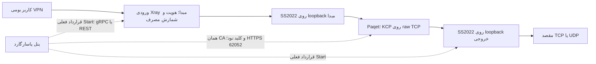
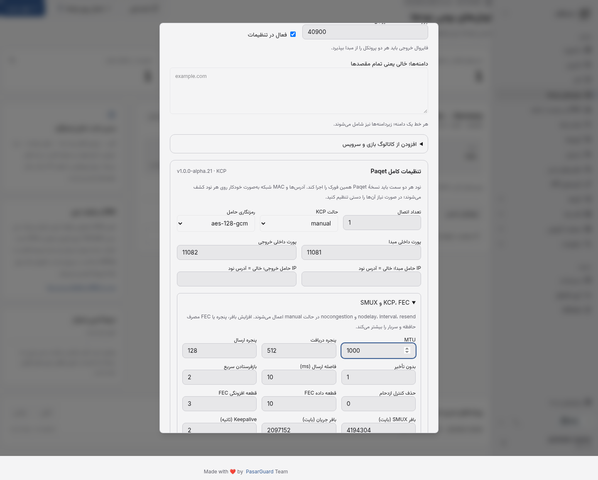

# Paqet بومی در PasarGuard Plus

سورس کامل نود رسمی و Paqet در همین فورک، زیر [node](../node) و [node/paqet](../node/paqet) نگهداری می‌شود. نسخهٔ پایهٔ Paqet، `v1.0.0-alpha.21` با commit `4b81ce0ab56b7cc9aec7501c87c4804676cdb1b4` است؛ منشأ و مجوزها در [UPSTREAM.json](../node/UPSTREAM.json) و فایل‌های LICENSE حفظ شده‌اند. هیچ پنل، دیتابیس یا API کنترل دونینو لازم نیست.

## معماری



Paqet خودش پنل کاربران VPN نیست؛ حامل بین نودهاست. لایهٔ داخلی SS2022 اتصال مسیر را احراز هویت می‌کند و ورودی کاربران و شمارنده‌های فعلی پاسارگارد در مبدا حفظ می‌شوند. مصرف بعد از restart هسته در شمارندهٔ همان اجرای جدید شروع می‌شود؛ جمع‌آوری دوره‌ای مصرف همچنان بر عهدهٔ سازوکار موجود پاسارگارد است. فوروارد و SOCKS اضافی مستقیماً متعلق به Paqet هستند و سهمیهٔ کاربر VPN را enforce نمی‌کنند؛ فعال‌سازی آنها به پذیرش صریح این موضوع نیاز دارد.

## ساخت و ارتقای نود

این قابلیت به **نود همین فورک روی Linux** نیاز دارد. افزودن ردیف نود یا نصب نسخهٔ رسمی قدیمی، باینری Paqet را نصب نمی‌کند. قبل از تغییر سرویس، از تنظیمات، گواهی و دیتابیس نسخهٔ پشتیبان بگیرید و اجرای نود قبلی را با همین نام سرویس هم‌زمان نگه ندارید.

روی هر دو سرور، مخزن همین شاخه را دریافت کنید. گواهی، کلید خصوصی و UUID فعلی نود را حفظ کنید و مسیرهای محیط نصب خود را در `.env` تنظیم کنید:

```sh
cd node
cp .env.example .env
# ویرایش .env با API_KEY و مسیر گواهی فعلی نود
# ساخت از تمام سورس‌های موجود در همین پوشه

docker compose -f compose.plus.yml build
# پس از توقف سرویس قبلی و تطبیق volume گواهی/داده:
docker compose -f compose.plus.yml up -d
```

فایل [compose.plus.yml](../node/compose.plus.yml) از host network، دسترسی‌های `NET_RAW` و `NET_ADMIN` و volume پایدار `/var/lib/pg-node` استفاده می‌کند. اگر نصب قبلی volume یا مسیر دیگری دارد، همان داده و گواهی را صریحاً نگاشت کنید. پورت مدیریتی فعلی نود پیش‌فرض `62050` باقی می‌ماند؛ افزونهٔ Paqet در `62052/TCP` با **همان گواهی و API_KEY** پاسخ می‌دهد. دسترسی این دو پورت را برای پنل محدود کنید. پورت raw حامل را برای IP نود مقابل مجاز کنید. صفحهٔ ویرایش نود در پنل، پورت API تونل را نیز ذخیره می‌کند.

Dockerfile.plus، نود و Paqet را از سورس کامپایل می‌کند؛ Paqet به libpcap نیاز دارد. Xray `26.10.21` و داده‌های geo با بررسی checksum ساخته/دریافت می‌شوند. build به اینترنت و Go moduleها نیاز دارد؛ برای نصب مستقیم، مسیرهای باینری و state را با متغیرهای زیر تنظیم کنید. نسخهٔ جدید Go و ابزارهای libpcap/iptables/iproute2/ping لازم هستند.

| متغیر | پیش‌فرض نصب مستقیم |
|---|---|
| `PG_NODE_PAQET_ENABLED` | `false`؛ در تصویر Plus برابر true |
| `PG_NODE_PAQET_PORT` | `62052`، جدا از SERVICE_PORT |
| `PG_NODE_PAQET_BINARY` | `/usr/local/bin/paqet` |
| `PG_NODE_PAQET_STATE_DIR` | `/var/lib/pg-node/paqet` |

گزینهٔ قدیمی «به‌روزرسانی نود» باینری upstream را دریافت می‌کند و جایگزین روش ارتقای این فورک نیست. پنل برای نودی که در مسیر Paqet ثبت شده آن عملیات را رد می‌کند؛ image همین فورک را بازسازی و سرویس را ارتقا دهید. به‌روزرسانی مستقل Xray رفتار موتور را تغییر می‌دهد و به پذیرش مجدد نیاز دارد.

## تنظیم از پنل

1. migration پنل را با `alembic upgrade head` اعمال کنید و هر دو نود را با گواهی و UUID صحیح ثبت کنید.
2. در «تونل‌های بومی نودها»، حامل **Paqet**، مبدا، خروجی و ورودی کاربران را انتخاب کنید. نوع حامل بعد از ساخت ثابت است؛ برای تغییر نوع، مسیر قبلی را غیرفعال، اعمال و حذف کنید.
3. «بررسی قابلیت» را برای هر دو نود اجرا کنید. پاسخ باید قرارداد `1`، نسخهٔ engine مورد نیاز و نصب باینری را تأیید کند. این پاسخ، تست ترافیک نیست.
4. اگر آدرس مدیریتی نود hostname، پشت NAT یا متفاوت با مسیر حامل است، IP عددی مبدا و خروجی را در تنظیمات Paqet مشخص کنید. پیش‌فرض interface/IP/MAC از route و ARP/ND نود کشف می‌شود. برای چند NIC، IPv6 یا routing ویژه، override دقیق interface، IP:port و MAC روتر را وارد کنید. IP محلی باید واقعاً روی همان interface باشد.
5. تنظیمات را ذخیره و «اعمال روی نودها» را اجرا کنید. خروجی پیش از مبدا اعمال می‌شود؛ restart می‌تواند اتصال‌های موجود را قطع کند. تغییر ذخیره‌شده تا تأیید نسخهٔ جدید، اعمال‌شده محسوب نمی‌شود.
6. وضعیت فرایند، لاگ پالایش‌شده، نسخه، ping سمت client و dump محدود سمت server از پنل قابل دسترسی است. restart نیاز به تأیید دارد. سپس با کلاینت واقعی TCP، UDP، IP خروجی و بازی موردنظر را آزمایش کنید.

## دامنهٔ تنظیمات

فرم فارسی/انگلیسی و JSON پیشرفته، تنظیمات Linux نسخهٔ pin‌شده را به compiler بومی می‌فرستند؛ فیلد ناشناخته رد می‌شود:

- پنج حالت KCP: normal، fast، fast2، fast3 و manual؛ تعداد اتصال‌ها، MTU، پنجره‌ها، nodelay/interval/resend/congestion، تأخیر نوشتن و ACK، FEC، bufferها و keepalive/timeout مربوط به SMUX.
- تمام ۱۵ block نسخهٔ upstream؛ پیش‌فرض `aes-128-gcm`. حالت‌های none/null به پذیرش صریح بدون رمز نیاز دارند. پذیرش نام cipher در پیکربندی، گواهی امنیت یا کارایی برابر همهٔ cipherها نیست.
- تنظیم جداگانهٔ client/server برای interface، IPv4/IPv6، MAC روتر، پورت محلی، buffer PCAP و TCP flagها. پورت ثابت مبدا فقط با یک اتصال مجاز است.
- پورت خام خروجی، دو پورت داخلی loopback، سطح لاگ و مدیریت اختیاری قواعد فایروال.
- فوروارد TCP/UDP اضافی به مقصد عددی loopback خروجی و SOCKS5 با نام کاربری/رمز. listener عمومی SOCKS بدون احراز هویت رد می‌شود. مسیر اصلی VPN به این گزینه‌ها نیاز ندارد.
- کلید Paqet و رمز SOCKS فقط نوشتنی هستند؛ ویرایش با رمز خالی، رمز ذخیره‌شدهٔ SOCKS را حفظ می‌کند. تعویض کلید مسیر، هر دو کلید داخلی و حامل را به نسخهٔ مطلوب جدید تغییر می‌دهد. کلیدها در دیتابیس/backup حساس‌اند و API آنها را بازنمی‌گرداند.

پنل سقف ۱۶ مسیر و همان محدودیت topology تونل بومی را حفظ می‌کند. خروجی مشترک به پورت خام و پورت داخلی متفاوت برای هر مسیر نیاز دارد. تداخل با ورودی‌ها و پورت‌های مدیریتی قبل از اعمال بررسی می‌شود؛ اشغال پورت توسط سرویس‌های خارج از پنل در runtime آشکار می‌شود. تنظیمات Windowsِ pcap با Linux برابر نیست و در این مسیر مدیریت نمی‌شود.

## پایداری و مالکیت

Supervisor داخل فرایند نود، config را پیش از توقف نسخهٔ قبلی بررسی می‌کند، فرایندهای فرزند را مدیریت می‌کند، شکست زودهنگام راه‌اندازی را به تنظیم قبلی برمی‌گرداند و فرایند مطلوبِ متوقف‌شده را با backoff دوباره اجرا می‌کند. journal خصوصی با مجوز 0600 و پوشهٔ 0700 بعد از restart نود بازیابی می‌شود. شناسهٔ UUID پایدار هر مسیر و tombstone نسخهٔ غیرفعال، مانع پذیرش درخواست قدیمی یا برخورد شناسه پس از حذف/ساخت مجدد می‌شوند.

قواعد NOTRACK، جلوگیری از RST و مجوز ترافیک، با IP دو سمت و پورت حامل محدود و با `pg-plus-paqet-{engine_id}` علامت‌گذاری می‌شوند. پاک‌سازی فقط همان قواعد را حذف می‌کند؛ هیچ جدول فایروالی flush نمی‌شود. اگر مدیریت قواعد را خاموش می‌کنید، قواعد متناظر raw TCP را خودتان آماده کنید. در خاموشی غیرمنتظره، قواعد باقی‌مانده با journal در راه‌اندازی بعدی تطبیق می‌یابند؛ دادهٔ volume را پیش از disable/apply حذف نکنید.

rollback محلیِ شروع فرایند با rollback توزیع‌شدهٔ دو نود متفاوت است. شکست نیمهٔ apply می‌تواند دو سمت را روی نسخه‌های متفاوت بگذارد؛ وضعیت pending را بررسی و apply را تکرار کنید. failover خودکار و تضمین عبور از هر فایروال/شبکه پیاده‌سازی نشده‌اند. downgrade دیتابیس تا حذف تمام ردیف‌های Paqet رد می‌شود: ابتدا disable، apply موفق و حذف مسیرها لازم است.

## شواهد و محدودیت پذیرش

- تست‌های Python: سطح تنظیمات، compiler، API واقعی، عدم افشای کلید، حفظ رمز، RBAC قبلی، تداخل پورت، تعویض کلید، هویت engine و عدم توقف core هنگام رد قرارداد Paqet.
- تست‌های Go با race detector: lifecycle، revision، idempotency، rollback شروع ناموفق، restore/tombstone، restart خودکار، احراز هویت API، redaction، محدودیت لاگ و قواعد scoped.
- build کامل تصویر از سورس انجام شد. آزمون Docker با دو نود واقعی همین تصویر، API واقعی پنل و Xray واقعی: TCP با payload شصت کیلوبایت، UDP با اندازه‌های ۳۲/۵۱۲/۱۲۰۰، SOCKS احراز هویت‌شدهٔ TCP/UDP، FEC دستی، تعویض کلید، شمارندهٔ کاربر و حذف قواعد پس از disable/apply موفق شد. دسترسی loopback echo فقط در fixture آزمایش مجاز شده است؛ قواعد تولید دست‌نخورده‌اند.
- جریان مرورگر با API و SQLite واقعی: ساخت و ویرایش تنظیمات، FEC/MTU، حفظ رمز، عدم افشای کلید، خطای قابلیت نود قدیمی و عرض موبایل بررسی می‌شوند.
- اندازهٔ buffer دیتاگرام upstream و fragmentation شبکه محدودیت واقعی‌اند؛ عبور دیتاگرام دلخواه تا ۶۵ کیلوبایت تضمین نمی‌شود. آزمون‌های این مرحله تا payload ۱۲۰۰ بایت هستند.
- این پذیرش آزمایشگاه Linux/IPv4 است؛ VPS ایران/خارج، IPv6 عملیاتی، کارایی/ظرفیت، packet loss و پذیرش بازی‌های واقعی هنوز سنجیده نشده‌اند. `running=true` و موفقیت apply، جایگزین تست مسیر نیستند.

اجرای آزمون‌ها پس از ساخت تصویر:

```sh
.venv/bin/pytest tests/test_native_paqet.py -q
(cd node && go test -race ./tunnel/paqet ./config)
# از ریشهٔ مخزن، با ابزارهای نصب‌شده و تأییدشده:
PAQET_DOCKER_IMAGE=pasarguard-plus-node:paqet \
PAQET_GO_BINARY=/absolute/path/to/go \
XRAY_TEST_BINARY=/absolute/path/to/xray \
.venv/bin/pytest tests/test_paqet_docker.py -q
# با Vite در 4173:
node dashboard/scripts/test-native-paqet-ui.mjs
```


