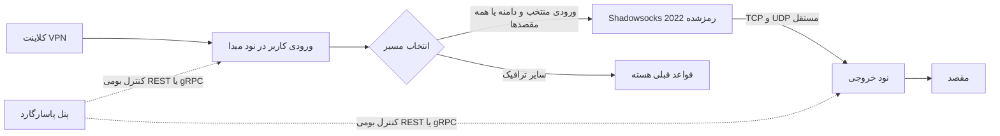
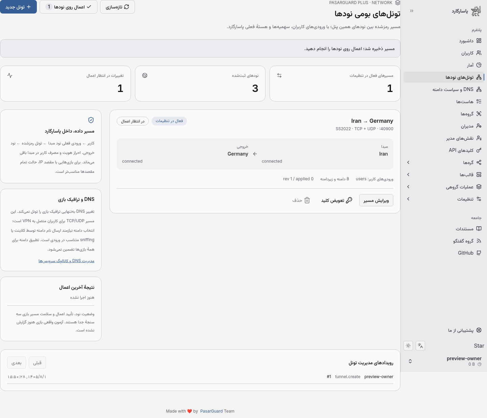
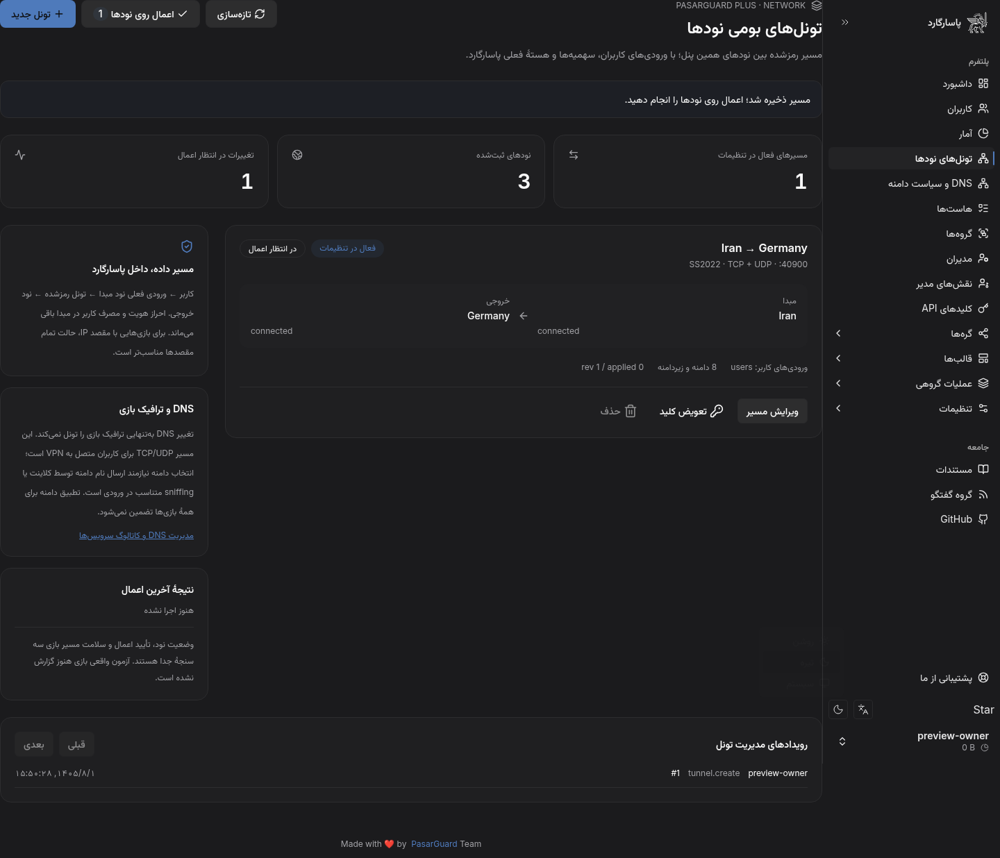

# تونل بومی نودها در PasarGuard Plus

این قابلیت داخل معماری پاسارگارد است: همان Node، CoreConfig، User، سهمیه VPN، احراز هویت مدیر و worker/NATS استفاده می‌شوند. پنل یا API کنترل دونینو لازم نیست. ثبت نود به‌تنهایی مسیر ترافیک نمی‌سازد؛ مسیر جدید در صفحهٔ **تونل‌های نودها** تعریف و روی نودها اعمال می‌شود.

## مسیر داده

- مبدا می‌تواند نود ایران و خروجی نود خارج باشد؛ محل نصب پنل مستقل از جهت ترافیک است.
- ورودی‌های کاربران تغییر نمی‌کنند. هویت، انقضا و مصرف در مبدا با مسیر فعلی پاسارگارد کنترل می‌شود. شمارش دیگری به مصرف کاربر اضافه نمی‌شود. آمار کلی دو نود همچنان دو مشاهدهٔ جدا از ترافیک هستند.
- حامل بین نودها `2022-blake3-aes-128-gcm` است، با کلید تصادفی مستقل برای هر مسیر. UDP روی این hop داخل TCP قرار نمی‌گیرد؛ پروتکل اتصال خود کلاینت به مبدا همچنان بر تأخیر اثر دارد.
- ورودی داخلی خروجی از همگام‌سازی کاربران مستثناست؛ تغییر کاربران، کلید ارتباط بین نودها را پاک نمی‌کند.
- تنظیمات اختصاصی هر نود هنگام `Start` ساخته می‌شود. تنظیم پایهٔ CoreConfig مشترک بازنویسی نمی‌شود؛ نود سومی که همان core را دارد تونل را دریافت نمی‌کند.
- پاسخ‌ها روی همان ارتباط TCP یا نشست UDP برمی‌گردند؛ قوانین NAT یا IP forwarding جدیدی توسط پنل به سیستم عامل تحمیل نمی‌شود.

## پیش‌نیاز و راه‌اندازی

1. همین شاخه را build کنید و طبق فرایند معمول ارتقای پاسارگارد، پیش از شروع نسخه جدید backup دیتابیس بگیرید و `alembic upgrade head` را اجرا کنید. revision جدید `e1b2c3d4a5f6` است؛ داده‌های کاربران و DNS قبلی حفظ می‌شوند.
2. نودهای رسمی را در بخش نودها ثبت کنید؛ هر دو طرف این حامل باید backend **Xray با پشتیبانی Shadowsocks 2022** داشته باشند. backend مستقل WireGuard در این مرحله حامل بین نودها نیست. نیازی به تغییر باینری سرویس رسمی نود برای قرارداد حاضر نیست.
3. برای خروجی، آدرس IPv4 قابل دسترسی از مبدا انتخاب کنید؛ listener فعلی تونل روی `0.0.0.0` است. ورودی IPv6 و انتخاب listener اختصاصی، پذیرش جداگانه می‌خواهند. کلید و CA مدیریت نود همچنان از مسیر استاندارد پاسارگارد تنظیم می‌شوند.
4. در فایروال خروجی، پورت انتخابی را برای **هر دو TCP و UDP** از IP مبدا مجاز کنید؛ پیش‌فرض `40900` است. اگر Docker نود استفاده می‌شود، هر دو پروتکل باید با همان پورت قابل دسترسی باشند. پورت مدیریت REST/gRPC نود با پورت تونل متفاوت است و API پورت یا فایروال را خودکار باز نمی‌کند.
5. به عنوان مالک، صفحهٔ «تونل‌های نودها» را باز کنید، مبدا/خروجی و حداقل یک ورودی کاربر را انتخاب کنید. مسیر را فعال و ذخیره کنید. برای بازی‌هایی با مقصد IP یا UDP بدون نام دامنه، حالت **تمام مقصدهای ورودی‌های منتخب** را انتخاب کنید.
6. «اعمال روی نودها» را اجرا کنید. این عمل هستهٔ نودهای مرتبط را راه‌اندازی مجدد می‌کند و می‌تواند اتصال‌های موجود را قطع کند. موفقیت هر نود و تغییرات در انتظار اعمال نمایش داده می‌شوند.
7. سپس با کلاینت واقعی، IP خروجی TCP، عبور UDP، تأخیر، ورود به بازی و matchmaking را جداگانه بررسی کنید. تأیید Start از طرف نود به معنی پذیرش بازی نیست.

فهرست دامنه‌ها را می‌توان دستی یا از همان کاتالوگ doctor-dns موجود در بخش DNS انتخاب کرد. suffix انتخابی، زیردامنه‌ها را هم شامل می‌شود. انتخاب دامنه تنها وقتی مؤثر است که کلاینت نام مقصد را بفرستد یا sniffing متناسبِ ورودی موجود، نام را فراهم کند؛ IP ثابت، ECH، QUIC یا رفتار متفاوت بازی می‌تواند این فرض را عوض کند. کاتالوگ، گواهی سازگاری همهٔ بازی‌ها نیست.

## مدیریت و شکست

- عملیات زیرساخت فقط برای **مالک پنل** مجاز است. API هم همین محدودیت را enforce می‌کند؛ پنهان‌بودن گزینه در رابط تنها کنترل دسترسی نیست.
- ذخیره، اعمال و سلامت ترافیک سه وضعیت جدا هستند. `revision` و `applied_revision` آخرین اعمال تأییدشده را مشخص می‌کنند. وضعیت لحظه‌ای نود هم جدا نمایش داده می‌شود؛ شمارندهٔ مسیر فعال در تنظیمات، ادعای اتصال سالم نیست.
- قفل استقرار در دیتابیس مشترک است؛ چند API worker یا NATS worker نمی‌توانند هم‌زمان apply کنند. در زمان apply، ویرایش مسیر و تغییرات زیرساخت مرتبط رد می‌شود؛ تراکنش نوشتن هنگام RPC شبکه باز نمی‌ماند.
- پاسخ busy یا timeout مبهم در Start به معنی تأیید نسخه جدید نیست؛ attach به هستهٔ قبلی برای ثبت `applied_revision` کافی محسوب نمی‌شود و تغییرات در انتظار می‌مانند.
- برای مسیر فعال، ابتدا خروجی و سپس مبدا اعمال می‌شود. برای حذف مسیر، ابتدا مبدا از تونل جدا می‌شود. شکست یک مرحله اعمال مراحل وابسته را متوقف می‌کند. timeout، لغو و شکست ناقص در نتیجه ثبت می‌شوند و نیاز به بررسی/تلاش مجدد دارند؛ rollback خودکار توزیع‌شده ادعا نمی‌شود. بعضی نودها ممکن است تنظیم قبلی و بعضی تنظیم جدید را داشته باشند.
- مسیر رمز‌شدهٔ اعمال‌شده، با قطع خروجی به `freedom` برنمی‌گردد. در اولین apply ناموفق، ممکن است مبدا هنوز تنظیم **قبلی** خود را اجرا کند؛ پیش از تأیید اعمال، ترافیک را مشمول تونل فرض نکنید.
- تعویض کلید ابتدا نسخهٔ مطلوب را عوض می‌کند؛ تا apply، نودها همان کلید قبلی را اجرا می‌کنند. اعمال کلید جدید می‌تواند ارتباط را موقتاً قطع کند. کلید خام از API مدیریتی یا رویدادها برنمی‌گردد؛ در دیتابیس با همان مرز حفاظت کلیدهای CoreConfig بومی نگهداری می‌شود. backup دیتابیس حساس است.
- برای حذف، مسیر را غیرفعال، سپس با موفقیت apply و بعد حذف کنید. حذف یا جابه‌جایی آدرس/core نودهای مرتبط پیش از پاک‌کردن مسیر مجاز نیست. حذف core مرتبط و ویرایشی که ورودی منتخب را از بین ببرد نیز رد می‌شود، حتی با SQLite بدون enforce کلید خارجی.
- در این نسخه، هر مبدا یک خروجی فعال دارد، مبداها و خروجی‌ها نقش‌های جدا دارند و سقف ۱۶ مسیر است. حلقه، زنجیره و تداخل پورت رد می‌شوند. چند مبدا می‌توانند خروجی مشترک با پورت‌های متفاوت داشته باشند.
- در حالت split، apply به RPC بومی worker نود فرستاده و پاسخ آن دریافت می‌شود؛ فقط انتشار fire-and-forget به عنوان موفقیت اعلام نمی‌شود. پیام خطای احتمالی هسته که می‌تواند تنظیمات حساس داشته باشد به پاسخ عمومی کپی نمی‌شود.
- صفحه رویدادها، ساخت/ویرایش/تعویض کلید/حذف و شروع/نتیجهٔ apply را با مدیر عامل نشان می‌دهد.

## قرارداد API

| مسیر | کاربرد |
|---|---|
| `GET /api/tunnels` | مسیرها، انتخاب‌گر نود/ورودی و وضعیت آخرین اعمال؛ بدون کلیدها |
| `POST /api/tunnels` | ساخت مسیر مطلوب |
| `PUT /api/tunnels/{id}` | ویرایش با `expected_revision` |
| `POST /api/tunnels/{id}/rotate` | تعویض کلید با کنترل نسخه |
| `POST /api/tunnels/apply` | اعمال مرحله‌ای روی runtime بومی نود |
| `DELETE /api/tunnels/{id}` | حذف مسیر غیرفعالِ اعمال‌شده با کنترل نسخه |
| `GET /api/tunnels/audit` | رویدادهای صفحه‌بندی‌شده |

OpenAPI و کلاینت TypeScript از همان مدل‌های Pydantic تولید شده‌اند. هیچ endpoint عمومی برای دریافت shared key یا اجرای فرمان دلخواه روی نود ایجاد نشده است.

## مرز DNS گیمینگ و SmartDNS

DNS بومی همچنان DoH، UDP، TCP و DoT، سیاست دامنه، سهمیه درخواست و IP lease دارد. این تونل، **مسیر TCP/UDP کاربر VPN** را تکمیل می‌کند. تغییر DNS تنها، UDP دلخواه بازی را به خروجی این تونل نمی‌فرستد. برای کاربر بدون VPN، SmartDNS واقعی به gateway مجاز، relay TLS/QUIC و راه‌حل ترافیک IP با کنترل مصرف بایتی نیاز دارد؛ آن زیرسامانه و failover خودکار هنوز پیاده‌سازی نشده‌اند. راهنمای DNS در [این فایل](DONINO-INTEGRATION.fa.md) و ماتریس ادامه در [نقشهٔ ارتقا](NATIVE-UPGRADE-PLAN.fa.md) است.

FRP، Paqet، Continuum، OpenVPN، device credentials و بودجهٔ مشترک آفلاین هنوز engine اجراشدهٔ این نود نیستند. افزودن نام یا فرم بدون runtime و آزمون، به عنوان پشتیبانی پروتکل حساب نشده است.

## شواهد فنی

- کد رسمی [PasarGuard/node](https://github.com/PasarGuard/node/tree/47857d43fe777f30f9ecc5f2ffe4ca0b037507cb) بررسی شد: قرارداد `Backend` در `common/service.proto`، مسیر Start و exclude کاربران در `backend/xray/config.go`، و backendهای Xray/WireGuard. همان قرارداد Start استفاده می‌شود؛ اتصال مدیریتی با حامل داده اشتباه گرفته نشده است.
- آزمون کنترل دسترسی واقعی API، حفظ core مشترک، سیاست دامنه، قفل استقرار بین workerها، کنترل revision، تعویض کلید، جلوگیری از حذف نود/core، شکست مرحله‌ای و بارگذاری overlay در restart در `tests/test_native_tunnels.py` است.
- آزمون واقعی سه فرایند Xray به همراه echo TCP/UDP در `tests/test_native_tunnel_traffic.py`: مسیر کامل و دامنه‌ای، ۱۱ کیلوبایت TCP، UDP با اندازه‌های ۳۲/۵۱۲/۱۲۰۰ و قطع خروجی بدون برگشت مستقیم. نسخهٔ آزموده `26.10.21`، SHA256 آرشیو رسمی: `0eec3ed4163c273d8c8bf821f7d219e257921cf584aa3fb970715e458e631978`. این آزمون opt-in است و خودش باینری دانلود نمی‌کند. اجازهٔ مقصد loopback فقط در fixture آزمایش داده می‌شود؛ تنظیم تولید، محدودیت‌های Xray را تغییر نمی‌دهد.
- اجرا: `XRAY_TEST_BINARY=/absolute/path/to/xray .venv/bin/pytest tests/test_native_tunnel_traffic.py -q`.
- مرورگر به API واقعی و SQLite موقت متصل است؛ ساخت، انتخاب از کاتالوگ، ویرایش، تعویض کلید، خطای واقعی apply با credential نامعتبر fixture، تم و عرض ۳۹۰ بررسی می‌شوند: `dashboard/scripts/test-native-tunnels-ui.mjs`. ابتدا Vite روی پورت 4173 اجرا شود.
- migration روی دیتابیس قبلی DNS ارتقا داده شد؛ `alembic check` اختلاف مدل/اسکیما گزارش نکرد. PostgreSQL/MySQL، خوشهٔ واقعی NATS و شبکهٔ VPS در این مرحله اجرا نشده‌اند.

