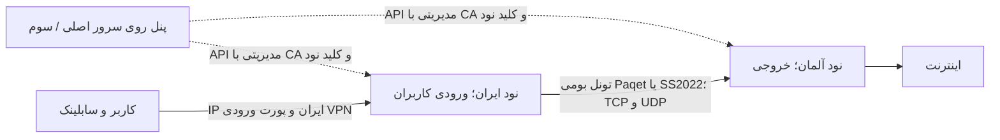
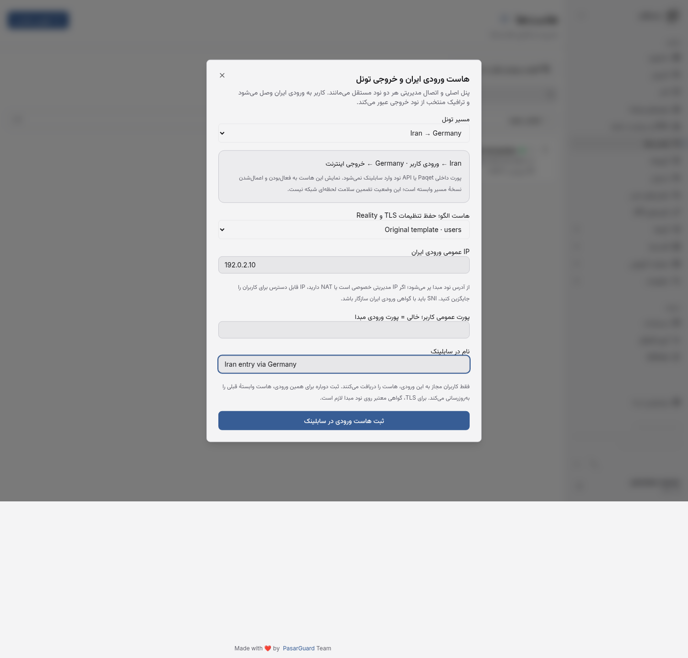

# پنل مستقل، نود ایران و خروجی آلمان

محل پنل، مبدا تونل و خروجی تونل سه نقش مستقل‌اند. پنل می‌تواند روی سرور سوم باشد؛ هر دو نود ایران و آلمان با اتصال مدیریتی خودشان به همان پنل ثبت می‌شوند. برای استفاده از نود ایران به‌عنوان ورودی کاربران و آلمان به‌عنوان خروجی، مبدا را ایران و خروجی را آلمان انتخاب کنید. نیازی نیست پنل را روی یکی از این دو سرور منتقل کنید.



اتصال مدیریتی، خودِ تونل داده نیست. تغییر مسیر داده، آدرس/API key/گواهی دو نود را به آدرس دیگری تبدیل نمی‌کند. مدیریت، آمار و همگام‌سازی کاربران با سازوکار پاسارگارد ادامه دارد. اگر قرار است تمام ترافیک از آلمان خارج شود، دامنه‌های مسیر را خالی بگذارید؛ مسیر دامنه‌ای فقط مقصدهای منتخب را می‌فرستد.

## راه‌اندازی از پنل

1. هر دو نود را در همین پنل ثبت کنید. برای Paqet، روی هر دو سرور نودِ همین فورک نصب باشد؛ [راهنمای نود و Paqet](NATIVE-PAQET.fa.md).
2. در تونل‌های بومی، مبدا ایران، خروجی آلمان و ورودی کاربران ایران را انتخاب کنید. از پورت raw تونل و پورت API نود برای اتصال کاربران استفاده نکنید.
3. تنظیمات را فعال، ذخیره و اعمال کنید؛ نتیجهٔ هر دو سمت و revision باید تأیید شده باشد.
4. در **هاست‌ها**، گزینهٔ **«افزودن ورودی تونل به سابلینک»** را باز کنید. این ابزار زیرساختی فقط برای مالک نمایش داده می‌شود و API هم مالک را بررسی می‌کند.
5. مسیر اعمال‌شده و هاست الگوی دارای همان inbound را انتخاب کنید. آدرس از نود مبدا پر می‌شود؛ اگر آدرس مدیریتی، خصوصی یا hostname است، IP قابل دسترس ایران برای کاربران را وارد کنید. IPv4 و IPv6 عددی پشتیبانی می‌شوند؛ IP نامشخص، loopback، multicast و link-local رد می‌شوند. بررسی امکان دسترسی از اینترنت همچنان لازم است.
6. پورت خالی، پورت ورودی کاربران **core نود مبدا** را انتخاب می‌کند؛ پورت خارجی reverse proxy یا NAT را می‌توانید صریحاً وارد کنید. برای inbound چندپورتی، پورت عمومی مشخص لازم است. ورودی Unix socket یا listener صرفاً loopback به‌عنوان ورودی عمومی این ابزار پذیرفته نمی‌شود؛ ابتدا ورودی قابل دسترس مبدا را تنظیم کنید.
7. ثبت کنید. هاست معمولی جدیدی با وابستگی به مسیر ساخته می‌شود و کاربران مجاز به همان inbound آن را در اشتراک می‌گیرند. ثبت دوبارهٔ همان ورودی، اولین هاست وابستهٔ آن مسیر/ورودی را به‌روزرسانی می‌کند؛ ردیف تکراری تولید نمی‌شود. هاست الگو دست‌نخورده می‌ماند.

هاست الگو برای حفظ تنظیمات کلاینت از جمله SNI، TLS، path، fingerprint و تنظیمات حمل استفاده می‌شود؛ پیش‌فرض‌های inbound از **core نود مبدا** خوانده می‌شوند، حتی اگر core دیگری tag یکسانی داشته باشد. گواهی TLS باید روی ورودی ایران برای همان SNI معتبر باشد؛ این ابزار گواهی صادر یا نصب نمی‌کند و اعتبارسنجی گواهی کلاینت را خاموش نمی‌کند. برای Reality، تنظیم کلید و short ID از inbound مبدا آماده می‌شود.

الگوی `use_sni_as_host` برای این ابزار رد می‌شود، چون آدرس اتصال را از IP ایران به SNI عوض می‌کند. همچنین الگوی xHTTP دارای download host مجزا رد می‌شود تا نیمهٔ دانلود ناخواسته از سرور دیگری عبور نکند. ابتدا این تنظیمات الگو را با مسیر موردنظر هماهنگ کنید. پورت‌های carrier و مدیریت نود نیز برای لینک کاربر رد می‌شوند.

## رفتار هاست وابسته

- ستون `hosts.native_tunnel_id` اتصال هاست به مسیر را نگه می‌دارد. هاست عادی بدون این مقدار، رفتار قبلی خود را دارد.
- فقط مسیر فعال با `revision == applied_revision` در اشتراک نمایش داده می‌شود. ویرایش و تعویض کلید، هاست را تا اعمال موفق نسخهٔ جدید از خروجی اشتراک حذف می‌کنند. شکست ناقص اعمال، آن را منتشر نمی‌کند. غیرفعال‌سازی مسیر نیز هاست را از اشتراک حذف می‌کند.
- حذف مسیر تا حذف یا جداکردن هاست‌های وابسته رد می‌شود؛ این محافظ در SQLite بدون enforce کلید خارجی نیز وجود دارد. هاست را می‌توان از همان صفحهٔ هاست‌ها حذف کرد. جداسازی با ارسال صریح `native_tunnel_id: null` در API هاست، فقط برای مالک مجاز است.
- ویرایش با کلاینت قدیمی که فیلد وابستگی را نمی‌فرستد، اتصال هاست را حفظ می‌کند. کپی از رابط جدید نیز وابستگی را حفظ می‌کند؛ صاحب دسترسی عادی نمی‌تواند با API هاست، اتصال زیرساختی تازه بسازد یا آن را جدا کند.
- کش هاست و خروجی اشتراک پس از تغییر مسیر بازسازی/پاک می‌شود. پیام NATS از worker نود، API workerها را به خواندن وضعیت تازهٔ دیتابیس وادار می‌کند؛ این worker، snapshot ناقص خودش را جایگزین همهٔ هاست‌ها نمی‌کند. کلید snapshot به `state_v5` تغییر کرده تا کش نسخهٔ قدیمی در ارتقا استفاده نشود. هنگام شروع API، اگر مسیر بومی وجود دارد، هاست‌ها از دیتابیس بازسازی می‌شوند تا تغییرِ worker در زمان خاموش‌بودن API با snapshot قدیمی پوشانده نشود.
- حذف از اشتراک، تنظیمات قبلاً واردشده در دستگاه کاربر را پاک یا credential کاربر را باطل نمی‌کند. اپ کلاینت باید اشتراک را به‌روزرسانی کند. غیرفعال‌کردن تونل با غیرفعال‌کردن حساب VPN یکی نیست.
- فعال/اعمال‌شده بودن، تضمین سلامت لحظه‌ای ترافیک نیست. در قطع شبکه، انتشار NATS، heartbeat و اطلاعات UI می‌توانند عقب بمانند؛ پذیرش واقعی مسیر و خوشهٔ عملیاتی همچنان لازم است.

## API و مهاجرت

`POST /api/tunnels/{id}/hosts`، مالک‌محور و با قفل استقرار و `expected_revision` است. ورودی:

```json
{
  "expected_revision": 1,
  "template_host_id": 7,
  "address": "203.0.113.10",
  "port": null,
  "remark": "Iran → Germany"
}
```

IPهای مثال برای مستندسازی‌اند و آدرس عملیاتی نیستند. آدرس خالی، IP نود مبدا را استفاده می‌کند. پورت خالی از inbound مبدا می‌آید. پاسخ همان `BaseHost` بومی به همراه شناسهٔ مسیر است؛ هیچ کلید carrier در پاسخ قرار نمی‌گیرد.

migration `a3d4e5f6b7c8` پس از migration Paqet اعمال می‌شود. روی کپی دیتابیس قبلی، ارتقا/بازگشت/ارتقا، حفظ مصرف و سهمیهٔ کاربر و هاست قدیمی و `alembic check` آزموده شد. downgrade تا وقتی هاست وابسته وجود دارد رد می‌شود.

## آزمون پذیرش

- `tests/test_tunnel_subscription_hosts.py`: API واقعی و RBAC، ثبت تکراری، پورت و IP، حفظ الگو، انتخاب core مبدا، محدودیت ورودی کاربر، خروجی لینک واقعی، ویرایش قدیمی هاست، pending/apply/rotation/disable، apply ناموفق، محافظ حذف و پیام worker/API.
- `dashboard/scripts/test-tunnel-hosts-ui.mjs`: API و SQLite واقعی، فرم فارسی و موبایل، IP و پورت خودکار، SNI، اشتراک تولیدشده، ثبت مجدد و حذف از اشتراک پس از غیرفعال‌سازی. Vite روی 4173 لازم است.
- `tests/test_paqet_docker.py`: پنل/API آزمایشی روی میزبان، دو نود واقعی، ثبت هاست از API، ساخت لینک با IP و پورت مبدا و اتصال Xray از همان مقادیر؛ عبور TCP/UDP و SOCKS، FEC/تعویض کلید، حذف هاست از اشتراک و دسترس‌پذیری API هر دو نود بعد از disable. این آزمون از تصویر source-built قبلی همین فورک استفاده می‌کند.

این شواهد مربوط به آزمایشگاه Linux/IPv4 است؛ روی VPS کاربر نصب یا تغییری انجام نشده و تست بازی/ISP، TLS واقعی عمومی، IPv6 و خوشهٔ واقعی NATS ادعا نمی‌شود.


